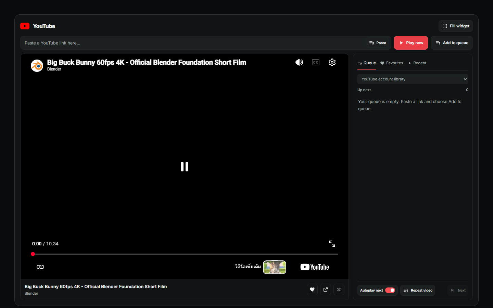
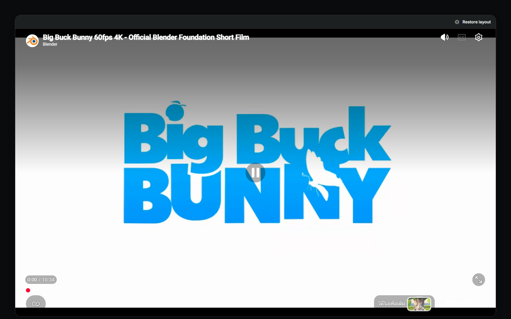

# Media player: YouTube and local video

Add **Media** from the dashboard’s **+** widget picker, then select **YouTube**. Existing
YouTube widgets keep their placement, settings and saved library. Paste a video link and
choose **Play now** or **Add to queue**. An account connection is not required
for pasted links, the queue, favorites, or recent videos.

Watch links, `youtu.be` links, Shorts, live-video links, embedded-video links, and
video IDs are accepted. A link’s `t` or `start` position is honored. A playlist-only
link does not identify a video; use the connected account’s playlist browser instead.

The video uses YouTube’s own play/pause, seek, volume, captions, quality and speed
controls where YouTube makes them available. There is no second playback toolbar
below it and no overlay intercepting touches on a working embed.

- **Fill widget** hides the link field, library and video details while keeping the
  same iframe mounted. **Restore layout** returns without restarting playback.
  Escape also returns when keyboard focus is on the dashboard; events inside the
  cross-origin YouTube player belong to YouTube, so the restore button remains visible.
- **Focus** centers the video over the dashboard and fits its 16:9 frame to the
  available window height (or width on narrow screens). The surrounding dashboard
  is blurred. Click or tap the blurred area, or press Escape while keyboard focus
  is on the dashboard to return. No exit button covers the video; a slim blurred
  margin remains on each side even in a 16:9 window. Focus is also available
  after **Fill widget** and restores that previous layout on exit. The same iframe
  stays mounted, so entering and leaving Focus does not restart the video.
- In a browser, YouTube’s fullscreen button opens the video fullscreen.
- In the native app, the separate **Full screen** button fills the dashboard
  window while preserving its kiosk/window state. Browser fullscreen remains
  disabled inside the native embed because exiting it previously broke kiosk state.
- **Queue** shows upcoming videos. **Next** starts the next video; **Autoplay next**
  advances when the current video ends. **Repeat video** takes priority over autoplay.
  Each upcoming item can be removed. Closing the player clears the current queue.
- The heart saves or removes the current video in **Favorites**. **Recent** records
  videos opened here. These lists, autoplay and repeat preferences are stored in this
browser, not synced across devices. Favorites are limited to 100 and recent videos
  to 30; the current session queue is limited to 100 entries. Reloading does not autoplay.
- **YouTube account library** retains liked videos, playlists, subscriptions and
  search. Connect the account under **Settings → Streaming** to use these features.

Titles and channel names update when the embedded player reports them. Until then,
an unsourced title is shown as a video ID. Videos that cannot be embedded offer
**Open in the browser**. A player configuration error is distinguished from a
video whose owner disallows embedding.

The existing Player and Library sections can still be hidden or reordered through
Edit Layout. A hidden Player section must be shown before playing a pasted link.

Validation covers URL and saved-data boundaries, origin/source checks, queue advance,
repeat/autoplay, storage failure, and the native fullscreen guard. Browser checks
cover signed-out playback, persisted favorites, iframe identity during fill/restore,
and desktop, 2560 × 720 Edge, portrait and phone layouts. Live Chromium playback was
verified using the Blender Foundation’s Big Buck Bunny video. Native window behavior
still requires a platform smoke test; its existing fullscreen guard is retained.

## Local video

Select **Video → Open files** to use the WebView/browser file picker, or drag video
files from Explorer onto Media. Dropping switches the widget to Video automatically.
The picker opens directly from the click; it does not launch a backend dialog that
can appear behind the dashboard. The subtitle picker works the same way in Focus.
The dashboard must be opened locally; paired phones and remote dashboards cannot
open or read the PC's video files. FFmpeg and its companion ffprobe must be installed
on that PC. Xenon reuses its existing FFmpeg discovery, including `XEH_FFMPEG` and
WinGet installations. Desktop drag-and-drop requires the native-shell build that
enables HTML file drops; the older shell intercepts them. File selection through the
button works independently of that shell change.

Supported file containers are MKV, MP4/M4V, MOV, WebM and AVI. Playback depends on
the contained codecs and the installed FFmpeg build. The session queue is not saved
across reloads, and files stay on the PC. File paths are never sent to the browser.
Selected browser files are copied once to private temporary storage on the same PC,
with progress and a Cancel button. They are not uploaded to an external service.
The original files stay untouched. Large files need time and temporary disk space
before playback starts; their bytes are streamed, not buffered into one RAM allocation.
Videos are limited to 16 GiB each, all prepared files to 32 GiB, and external subtitles
to 8 MiB. Imports leave at least 1 GiB of free disk space at admission and permit at
most two concurrent preparations. Normal cleanup releases the temporary copies with
their queue entries; abandoned copies are cleaned conservatively after a crash.
The local library holds up to 32 file grants. Use **Queue → Clear queue** to release
them and choose different files. Removing the widget or leaving the dashboard also
releases its file grants; switching between YouTube and Video retains the queue.

- **Audio & subtitles** lists the file's language tracks. Audio changes resume at
  the current position. Text subtitle changes do not restart the video.
- **Adjust subtitles** lets you drag captions to a position inside the video
  picture and change their text size. Use **Reset** to return to the default
  placement, then **Done** to finish. Arrow keys move the focused caption as an
  alternative to dragging. Position and size carry across Focus and widget resizing.
  Adjustments last for the current widget session; reloading restores defaults.
  This applies to selectable text subtitles, including external subtitle files;
  text burned into the video picture cannot be moved separately.
- Embedded text subtitles and external SRT, ASS, SSA and VTT are displayed as
  WebVTT captions. **ASS (text only)** preserves dialogue and timing, without advanced
  fonts, positioning or karaoke effects. Bitmap/PGS subtitles are shown as
  unsupported; use a text subtitle file for these videos.
- **Focus**, **Fill widget** and **Restore layout** retain the same video element.
  Focus fits the video's aspect ratio to the window and gives the full frame to the
  picture. Controls start hidden; click or tap the video to reveal them over the
  picture, then they hide after inactivity. Keyboard navigation also reveals them.
  Audio/subtitle menus and file preparation remain visible while in use.
  Escape or a tap outside the Focus dialog returns to the dashboard.
- Switching to YouTube, hiding the page, removing the widget or pausing stops the
  local stream. Press Play to resume from the saved position. Only one local player
  in the same dashboard plays at a time.

### Resource usage

Compatible H.264 video is copied into a browser-compatible MP4 stream without
decoding/re-encoding the picture. AAC audio is copied when possible; other selected
audio is converted to stereo AAC. Other video formats use compatibility conversion,
limited to 720p and two encoding threads. This mode costs CPU and can reduce image
quality; its indicator is shown beside the filename.

There is no library scan, background thumbnail generation or playback polling loop.
Metadata is read only for selected files. Subtitle extraction is bounded and cached,
and paused/hidden players release their FFmpeg stream. The browser still uses CPU/GPU
to decode and display video, so resource usage depends on resolution, codec and hardware.

Local file grants, stream counts, subtitle extraction concurrency and cache size are
bounded. Same-origin and loopback checks protect every local-video endpoint, including
streams and captions; these routes do not offer JSONP or permissive CORS.

An isolated Windows measurement of 20 seconds of 1080p H.264/AAC copy playback
used 1.73% of one logical CPU on average and 23.44 MiB peak FFmpeg working set.
No tracked playback process remained 500 ms after stopping. These figures describe
the remux worker, excluding the browser's video decoding/GPU usage, and are not a
performance guarantee for other codecs or computers.
